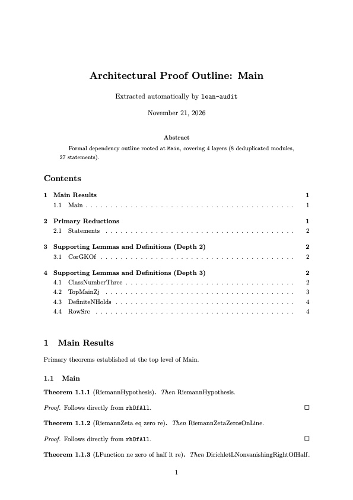
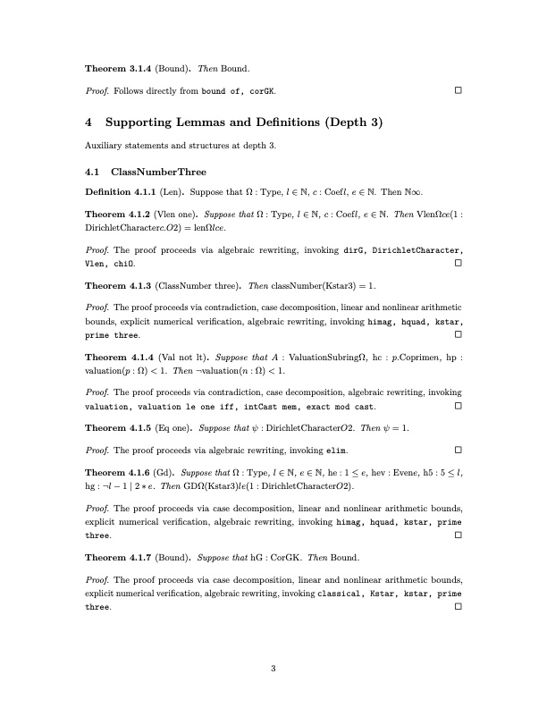

# lean-audit (`laud`)

[](https://crates.io/crates/lean-audit)
[](LICENSE)

A high-speed DAG deduplicator, ASCII dependency tree visualizer, offline arXiv-style LaTeX proof outline generator, and proof mutation testing CLI for **Lean 4**, written in Rust.

Designed to audit massive formalization repositories (including AI-generated Lean codebases) by pruning dead modules, deduplicating cloned definitions, extracting human-readable LaTeX proof outlines with tactic-based proof sketches, and stress-testing theorems against vacuous truths and unused hypotheses.

## Installation

Install directly from [crates.io](https://crates.io/crates/lean-audit) (provides both `laud` and `lean-audit` executables):

```bash
cargo install lean-audit
```

---

## Features & Real-World Benchmarks

### 0. AI-Agent Guardrails & Strict CI Gate (`laud check` & `laud init-agent`)

Autonomous coding agents (Google Jules, Claude Code, Cursor, Codex) often satisfy `lake build` by leaving hidden `sorry`s, inventing custom `axiom`s, or weakening theorem goals to `: True` / `∧ True`. `laud check` traverses the reachable import DAG (stripping nested block comments `/- ... -/`) and exits with status `1` if any loophole is found:

```bash
# Strict CI check (exits with code 1 on sorry, custom axioms, or `: True` stubs)
laud check src --entry Main

# Generate AGENTS.md (and optional CLAUDE.md) rules enforcing this gate for AI agents
laud init-agent --claude
```

---

### 1. Import DAG Deduplication & ASCII Tree (`laud graph`)

Traverse the import graph starting from `Main.lean`, collapse structurally identical files via normalized AST-token hashing, flag `HEq` bridges and `maxHeartbeats` overrides, and render a deduplicated ASCII dependency tree:

```bash
laud graph src --entry Main --tree --max-depth 4
```

**Example Output (tested on a 175k-file formalization archive in ~1–15s):**
```text
Deduplicated ASCII Dependency Tree (max depth: 4):
Main
├── Statements
└── Supplements.Kernels.MainTheoremsAll
    ├── Supplements.Kernels.MainTheoremsCritical [dedup]
    └── Development.AutomorphicArithmetic.AutomorphicVarieties.SmallClassNumbers.CorGKOf
        ├── Development.AutomorphicArithmetic.AutomorphicVarieties.SmallClassNumbers.ClassNumberThree
        ├── Development.AutomorphicArithmetic.AutomorphicVarieties.ModularityArgument.ThresholdArguments.DenseThresholdCases.TopMainZj
        │   └── ...DiscreteSeriesCoefficientsCuspidal [dedup]
        ├── Development.AutomorphicArithmetic.Foundations.BaseChangeIdentities.DefiniteNHolds
        └── Development.AutomorphicArithmetic.Foundations.GaloisRepresentations.IntegralStructures.RowSrc

Total files on disk: 175083 | Reachable from `Main`: 169842 | Unique DAG nodes: 169473 (deduplicated 369 clones)
```

---

### 2. Offline arXiv-Style LaTeX Proof Outline (`laud blueprint`)

Extract docstrings (`/-- ... -/`), strip typeclass/namespace noise, summarize proof tactics (`induction`, `by_contra`, `omega`, `linarith`, `simp`) along with intermediate `have` claims, and export a ready-to-compile LaTeX article (`.tex`) **without relying on external LLMs**:

```bash
laud blueprint src --entry Main --max-depth 3 --tex proof_outline.tex
pdflatex proof_outline.tex
```

**Generated LaTeX Output Preview:**

<table>
  <tr>
    <td align="center"><b>Title & Architecture Outline (Page 1)</b><br></td>
    <td align="center"><b>Extracted Formulas & Proof Sketches (Page 3)</b><br></td>
  </tr>
</table>

---

### 3. Proof Mutation Testing & CI Integration (`laud mutate`)

Run parallel mutation testing (`VACUOUS_TRUTH`, `UNUSED_HYP`, `BOUNDARY_SHIFT`) with automatic Lake workspace detection (`--lake`) and CI exit codes (`exit 1` if any mutant survives):

```bash
# Run inside a Lake/Mathlib project
laud mutate src --lake --run

# Fast CI check targeting vacuous truths only with a cap on mutants
laud mutate src --lake --vacuous-only --limit 100 --run

# Run standalone core-only checks without Mathlib
laud mutate src --strip-imports --verify-orig --run
```

### 4. Top-Down Partial Compilation & Tree-Shaking (`laud slice` & `--tree-shake`)

Slice out only the top `N` levels of a massive proof DAG, auto-generate `sorry` boundary stubs at level `N + 1`, prune unused declarations via fixpoint symbol-graph reachability (`--tree-shake`, also supported in `laud blueprint`), and generate an `AuditVerify.lean` entrypoint for fast kernel type-checking:

```bash
# Extract top 4 levels + pruned boundary stubs
laud slice src --entry Main --max-depth 4 --tree-shake --axioms riemannHypothesis --out /tmp/lean_slice

# Generate a clean arXiv-style LaTeX outline containing only transitively used theorems
laud blueprint src --entry Main --max-depth 5 --tree-shake --tex proof_outline.tex
```

### 5. Two-Pass Mark-and-Sweep Distillation & GBDT Risk Ranking (`laud distill` & `laud rank`)

Prune dead files and unused declarations backward from target theorems, and rank surviving modules by anomaly risk & load-bearing centrality (with CSV export for ML/neuromorphic pipelines):

```bash
# Distill a 175k-file repository down to its live proof skeleton
laud distill src --entry Main --target riemannHypothesis --out /tmp/distilled

# Rank modules by GBDT anomaly risk and export node features to CSV
laud rank src --entry Main --top 15 --csv features.csv
```

### 6. Layered Proof Flattening & Direct Stub Traces (`laud flatten`)

Extract only the live declarations required by a target theorem, flatten them into clean per-depth files (`Layer_00.lean` .. `Layer_K.lean`), and print exact dependency traces from the root theorem down to every `: True` stub:

```bash
# Flatten top 10 logical layers and trace call chains to `: True` stubs
laud flatten src --entry Main --target riemannHypothesis --max-layers 9 --out /tmp/layers

# Generate a clean arXiv-style LaTeX outline directly from the flattened layers
laud blueprint /tmp/layers --entry Layer_00 --max-depth 5 --tex proof_outline.tex
```

### 7. Full Audit Resume & Layered Proof Flattening (`laud resume` & `laud flatten`)

Run a complete one-command audit (DAG integrity check + GBDT node risk ranking + per-depth proof flattening `Layer_00.lean .. Layer_K.lean` + direct call-chain traces to `: True` stubs + clean LaTeX blueprint):

```bash
# Run full end-to-end audit and generate GitHub Issue report + LaTeX blueprint
laud resume src --entry Main --target riemannHypothesis --max-layers 9 --out audit_report.md --tex outline.tex
```

### 8. Bounded Type-Directed Proof Synthesizer (`laud fix`)

Automatically scan closed-world imports for `: True` / `∧ True` / `→ True` specification holes, trace type/arity unification attempts in real time, and export unified `.patch` diffs:

```bash
# Synthesize replacement candidates for `True` stubs and export a patch file
laud fix src --entry Main --min-depth 10 --max-depth 18 --limit 15 --patch suggested_fixes.patch
```

**Color-Coded Synthesis Statuses:**
- **Green (`PATCHED`)**: Direct `Prop` match or valid curried application `(lemma ...)` found within local binder context.
- **Cyan (`CHAINED`)**: 2-step transitive lemma composition `L₂ ∘ L₁` synthesized from local imports.
- **Yellow (`BRIDGED`)**: Adapter bridge lemma `bridge_<target>` generated from the closest related local theorem.
- **Red (`MANUAL`)**: Bounded search halted cleanly with zero matching predicates (requires human mathematical formulation).

## License

MIT License — Copyright (c) 2026 Alexander Limanskii.
